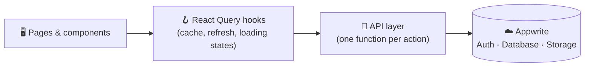

<div align="center">


### Share moments. Discover people. Stay in the circle.


</div>

---

## 📑 Contents

1. [💡 Concept](#-concept)
2. [✨ Features](#-features)
3. [⚙️ How it works](#️-how-it-works)
4. [🧠 Technical decisions](#-technical-decisions)
5. [🗂️ Project structure](#️-project-structure)
6. [🚀 Getting started](#-getting-started)
7. [🗺️ Roadmap](#️-roadmap)

---

## 💡 Concept

| | |
|---|---|
| **What** | A photo-sharing social app: post moments, like, save, follow people and explore what others share. |
| **Problem** | Big social apps are noisy: endless menus, ads and content you didn't ask for. |
| **Solution** | A calm, content-first space with one clear layout: **navigation** on the left, **feed** in the middle, **social context** (requests, suggestions) on the right. |
| **For whom** | People who want a simple place to share photos with friends, and developers looking for a clean, real-world React + BaaS reference. |

---

## ✨ Features

| | Feature | What you can do |
|---|---|---|
| 🔐 | **Accounts** | Sign up, sign in, stay logged in, sign out |
| 📝 | **Posts** | Create, edit and delete a post with a photo (drag & drop), caption, location and tags |
| 🏠 | **Home feed** | Newest posts with **infinite scroll**. Each card shows the whole post, so no extra clicks are needed |
| ❤️ | **Likes** | Like / unlike instantly. The post page shows *“Liked by Anna and 3 others”* |
| 🔖 | **Saved** | Save posts to your private **Saved** collection and remove them anytime |
| 👥 | **Follow** | Follow / unfollow people from **People** or their profile. Follower counts update live |
| 🔎 | **Explore** | Live search by caption or tag. Clicking a `#tag` opens matching posts |
| 🖼️ | **Post page** | Uncropped photo, likes summary, clickable tags and *“More from author”* |
| 👤 | **Profiles** | Posts & liked-posts tabs, follower / following stats, edit name, bio and avatar |
| 📱 | **Responsive** | 3 columns on desktop, top bar + bottom tab bar on mobile |

---

## ⚙️ How it works

### The big picture



**In plain words:** a screen never talks to the server directly. It asks a **hook** (e.g. `useLikePost`). The hook calls **one API function** and then tells every screen that uses the same data to refresh. That keeps likes, saves and follows **in sync everywhere at once**.

### Data model

| Table | Holds | Connected to |
|---|---|---|
| 👤 `users` | name, username, bio, avatar | ✍️ their **posts** · ❤️ **liked** posts · 🔖 **saves** |
| 🖼️ `posts` | photo, caption, location, tags | ✍️ **creator** (user) · ❤️ **likes** (users) |
| 🔖 `saves` | one saved post | 👤 **user** + 🖼️ **post** |
| 👥 `follows` | one “A follows B” | 👤 **follower** + 👤 **following** |

### Key flows

- ❤️ **Like:** the heart turns red **immediately**. The new list of likes is saved on the post, and the feed and post page refresh in the background.
- 🔖 **Save:** creates a `saves` row; un-saving deletes it. The **Saved** page reads your saves.
- 👥 **Follow:** creates a `follows` row; unfollow deletes it. **One shared “who I follow” list** decides the state of *every* Follow button on the screen, so there is one request instead of one per button.
- 🖼️ **New post:** upload photo → save post with the photo's URL. If saving fails, the uploaded photo is removed, so no orphan files are left.
- 🏠 **Infinite scroll:** posts load 10 at a time, ordered by creation date, so likes or edits never reshuffle a feed you're scrolling. Home and Explore share the same cached list.

---

## 🧠 Technical decisions

| Decision | Why |
|---|---|
| ☁️ **Appwrite** (Backend-as-a-Service) | Auth, database and file storage out of the box, so time goes into product and UX instead of servers. |
| 🎯 **Explicit relationship loading** (`Query.select`) | Appwrite doesn't return related data by default. Each request asks only for what the view needs: author, likes, saves. |
| 🔄 **TanStack Query** for all server data | Caching, background refresh and targeted cache refreshes. No hand-written loading/error state, no stale screens. |
| 🧭 **Cursor pagination by `$createdAt`** | Stable infinite scroll: a like changes `$updatedAt`, but never moves posts between pages. |
| 🏠 **Feed-first, no duplicate views** | The Home card already shows the full post, so it doesn't link to an identical details page. The post page adds new value instead. |
| ✅ **Zod + React Hook Form** | One validation schema per form gives typed values and clear error messages. |
| 🎨 **Tailwind v4 design tokens** | Colors, typography, one content width (`max-w-content`, 640px) and one page container (`page-container`). Every page looks consistent by default. |
| 🧩 **Single source of truth** | Every icon, asset path, nav link, query key, API call and style is defined **once** and imported everywhere else (see below). |
| 🛡️ **Strict TypeScript** | `strict`, `verbatimModuleSyntax` and `erasableSyntaxOnly` are on, and the project compiles with **0 errors**. |

---

## 🗂️ Project structure

> **Rule:** each thing lives in exactly one place. Components only *import* it.

```
src/
├── 🚪 main.tsx · App.tsx         App entry, providers and routes
│
├── 🔐 _auth/                     Logged-out area
│   ├── AuthLayout.tsx            Split screen; redirects logged-in users to Home
│   └── forms/                    SigninForm · SignupForm
│
├── 🏠 _root/                     Logged-in area
│   ├── RootLayout.tsx            Topbar · LeftSidebar · page · RightSidebar · BottomBar
│   └── pages/                    Home · Explore · AllUsers · Saved · CreatePost · EditPost
│                                 PostDetails · Profile · LikedPosts · UpdateProfile
│
├── 🧩 components/
│   ├── shared/                   Reusable app pieces
│   │   ├── Icons.tsx             ⭐ ALL inline SVG icons (color via currentColor)
│   │   ├── PostCard · PostStats · GridPostList · UserCard · FollowButton
│   │   ├── LeftSidebar · RightSidebar · Topbar · BottomBar
│   │   └── FileUploader · ProfileUploader · Loader
│   ├── forms/PostForm.tsx        One form for both Create and Update
│   └── ui/                       Base UI kit (shadcn): button, input, form, textarea, sonner
│
├── 🪝 hooks/
│   ├── useSignOut.ts             Sign out + reload (used by both sidebars)
│   ├── useImageDropzone.ts       Photo picking & preview (posts + avatars)
│   └── useDebounce.ts            Waits until typing pauses (search)
│
├── 📚 lib/
│   ├── appwrite/config.ts        ⭐ Appwrite client + all table IDs (from .env)
│   ├── appwrite/api.ts           ⭐ EVERY server call, grouped by topic
│   ├── react-query/queriesAndMutations.ts  ⭐ EVERY data hook + cache refresh rules
│   ├── react-query/queryKeys.ts  ⭐ All cache keys
│   ├── validation/index.ts       ⭐ All form schemas (Zod)
│   └── utils.ts                  Date formatting, class merging, small helpers
│
├── 📌 constants/index.ts         ⭐ Asset paths · nav links · accepted image types · mock data
├── 🧾 types/index.ts             ⭐ Shared TypeScript types
├── 🌐 context/AuthContext.tsx    Logged-in user, available app-wide
└── 🎨 globals.css                ⭐ Theme tokens + every reusable style (@utility)
```

⭐ = single source of truth for that kind of thing.

---

## 🚀 Getting started

```bash
npm install
npm run dev
```

Create `.env.local` with your Appwrite IDs:

```env
VITE_APPWRITE_ENDPOINT=
VITE_APPWRITE_PROJECT_ID=
VITE_APPWRITE_DATABASE_ID=
VITE_APPWRITE_STORAGE_BUCKET_ID=
VITE_APPWRITE_USERS_COLLECTION_ID=
VITE_APPWRITE_POSTS_COLLECTION_ID=
VITE_APPWRITE_SAVES_COLLECTION_ID=
VITE_APPWRITE_FOLLOWS_COLLECTION_ID=
```

---

## 🗺️ Roadmap

| | Next step | Size |
|---|---|---|
| 💬 | Comments under posts | 🟡 |
| 🏷️ | Clickable tags everywhere (Home cards, Explore) | 🟢 |
| 🔎 | Smarter search: partial words in captions, live results, exact tags | 🟡 |
| 🔒 | Private accounts with follow requests (accept / decline) | 🟡 |
| 🧭 | Real **Requests** & **Suggestions** in the right sidebar | 🟡 |
| 👥 | People search + pagination · followers / following lists | 🟡 |
| 🔗 | Share button (native share or copy link) | 🟢 |
| ✨ | Skeleton loaders · styled delete confirmation · error boundaries | 🟢 |
| ✉️ | Private messages with real-time updates | 🔴 |

🟢 small · 🟡 medium · 🔴 large. Full plan with steps: **[ROADMAP.md](ROADMAP.md)**
